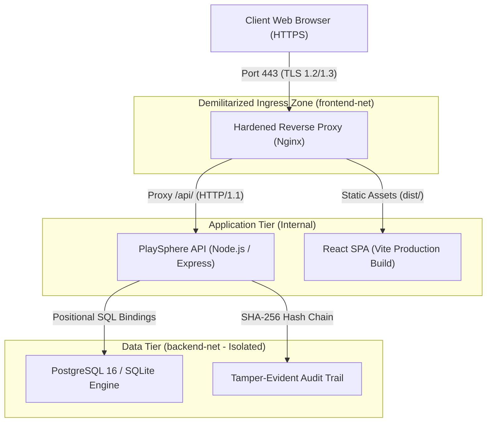
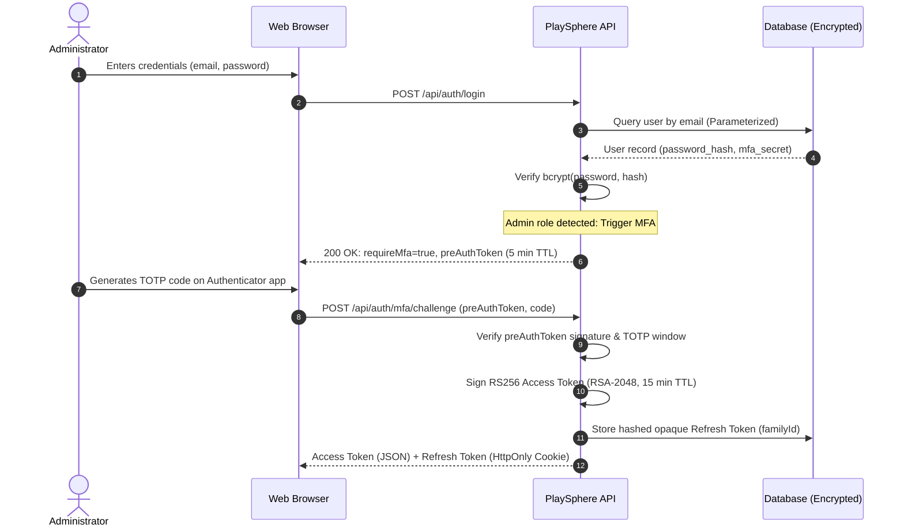
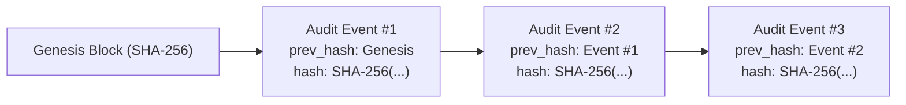

# PlaySphere Connect — Architecture & Security Engineering

This document specifies the technical architecture, network segmentation, cryptographic lifecycle, and data flow of the hardened PlaySphere Connect platform.

---

## 1. High-Level System Architecture

PlaySphere Connect employs a multi-tier, defense-in-depth architecture separating public ingress, application logic, and data storage across isolated network boundaries.

---

## 2. Network Segmentation & Traffic Matrix

The containerized deployment defines two distinct Docker bridge networks to eliminate direct database exposure:

1. **`frontend-net` (External Ingress):**
   - Connects public traffic to the Nginx reverse proxy.
   - Nginx proxies `/api/*` traffic to the Node.js API container on internal port 5000.
2. **`backend-net` (Internal Isolated Network):**
   - Marked `internal: true` (no external routing or egress).
   - Only the Node.js API container and the PostgreSQL container communicate over this network on internal port 5432.
   - Host machines and external networks cannot establish connections to port 5432.

### Network Traffic Matrix

| Source | Destination | Protocol | Port | Purpose | Encryption / Auth |
| :--- | :--- | :--- | :--- | :--- | :--- |
| Internet / Client | Reverse Proxy | HTTPS | 443 | End-user browsing & API requests | TLS 1.2/1.3, Strict Ciphers |
| Internet / Client | Reverse Proxy | HTTP | 80 | Initial web connection | Redirects 301 to HTTPS |
| Reverse Proxy | API Container | HTTP | 5000 | Reverse-proxied backend requests | Internal Docker network (`frontend-net`) |
| API Container | Database Container | PostgreSQL | 5432 | Parameterized queries & transactions | Internal Docker network (`backend-net`), SCRAM-SHA-256 |
| Client | API Container | HTTPS | 443 | Token refresh exchange | `HttpOnly`, `SameSite=Strict`, `Secure` Cookie |

---

## 3. Cryptographic Architecture & Key Management Lifecycle

### Key Management Lifecycle

1. **Key Generation (`server/scripts/gen-keys.ts`):**
   - Algorithm: Asymmetric RSA-2048 with PKCS#8 encoding.
   - Formats: PEM encoded private key (`jwt_private.pem`) and public key (`jwt_public.pem`).
   - Automated via `npm run gen-keys`.
2. **Key Storage:**
   - Private keys reside in `server/keys/jwt_private.pem` with Unix permissions `0600` (read/write by application process only).
   - Public keys reside in `server/keys/jwt_public.pem` and are publicly exposed via the JWKS endpoint `/.well-known/jwks.json` for distributed token verification.
   - Keys are explicitly ignored in `.gitignore` to prevent source repository leaks.
3. **Key Rotation & Verification:**
   - The token verification middleware strictly checks `alg === 'RS256'` and validates against the corresponding public key.
   - Algorithms `none`, `HS256`, and `HS512` are rejected unconditionally.
4. **Token Revocation & Rotation:**
   - **Access Tokens:** Stateless RS256 JWTs with a strict 15-minute Time-To-Live (TTL).
   - **Refresh Tokens:** 256-bit opaque tokens hashed with SHA-256 before storage.
   - **Token Family Invalidation:** Upon token refresh, the used token is marked revoked and rotated. If a revoked token is re-submitted, the entire family is revoked immediately to mitigate session hijacking.

---

## 4. Tamper-Evident Audit Logging Architecture

To ensure non-repudiation and forensic integrity, every security-relevant action is recorded in a cryptographically chained audit log.

### Chain Hashing Mechanism
For every audit log record $R_i$:
$$\text{hash}_i = \text{SHA-256}(\text{id} \parallel \text{timestamp} \parallel \text{event\_type} \parallel \text{actor\_id} \parallel \text{resource} \parallel \text{action} \parallel \text{outcome} \parallel \text{details\_json} \parallel \text{hash}_{i-1})$$

An administrative endpoint (`GET /api/admin/audit-logs/verify`) traverses the entire log sequence from genesis, computing running hashes to detect unauthorized modification, insertion, or row truncation.
